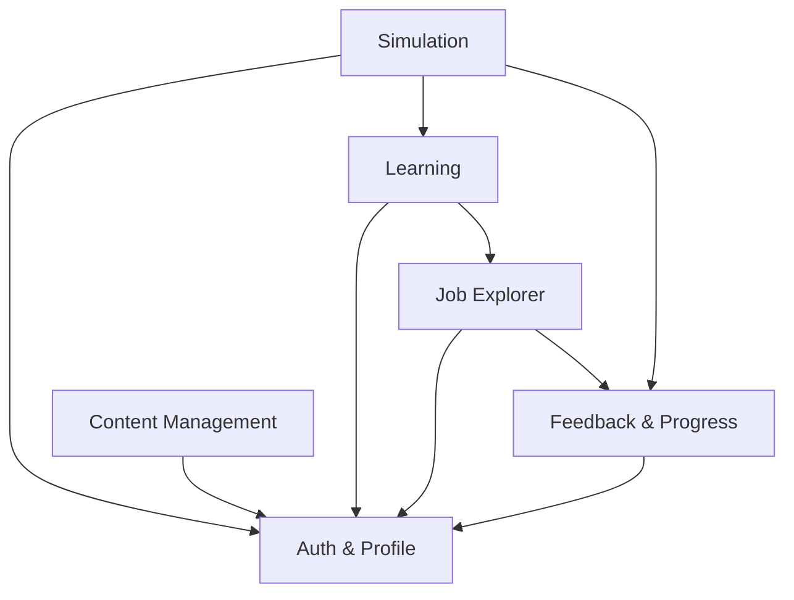

# D2. Module Breakdown

CareerUp dibagi menjadi **6 modul**. Setiap modul punya satu tanggung jawab utama agar mudah dikerjakan dan diuji terpisah.

## Daftar Modul

### 1. Auth & Profile
**Tanggung jawab:** Mengurus akun pengguna dan hak akses berdasarkan peran (Job Seeker atau Admin).

**Fitur utama:**
- Register akun baru
- Login dan logout
- Membedakan peran Job Seeker dan Admin
- Memeriksa hak akses sebelum halaman atau fitur dibuka

### 2. Job Explorer
**Tanggung jawab:** Menampilkan daftar pekerjaan beserta skill yang dibutuhkan, lalu membantu pengguna memilih pekerjaan target.

**Fitur utama:**
- Melihat dan mencari daftar pekerjaan
- Melihat skill yang dibutuhkan untuk tiap pekerjaan
- Memilih pekerjaan target
- Menampilkan roadmap belajar sesuai pekerjaan target

### 3. Learning
**Tanggung jawab:** Menyediakan materi belajar skill dasar dan latihan interaktif.

**Fitur utama:**
- Membaca materi per skill
- Mengerjakan latihan interaktif
- Menandai materi sebagai selesai

### 4. Simulation
**Tanggung jawab:** Menjalankan simulasi tugas kerja, memeriksa jawaban, dan menghitung skor.

**Fitur utama:**
- Menampilkan daftar task simulasi
- Menerima jawaban pengguna
- Validasi jawaban (misalnya tidak boleh ada yang kosong)
- Menghitung skor dan menentukan status kesiapan (`evaluate_simulation`)

### 5. Feedback & Progress
**Tanggung jawab:** Memberi feedback sesuai hasil simulasi dan mencatat perkembangan pengguna.

**Fitur utama:**
- Menampilkan feedback sesuai status (Siap / Hampir Siap / Perlu Latihan Lagi)
- Menyimpan riwayat hasil simulasi
- Menampilkan progres per pekerjaan
- Menyimpan pekerjaan target pengguna
- Menyarankan mengulang materi atau simulasi bila skor rendah

### 6. Content Management
**Tanggung jawab:** Memberi Admin alat untuk mengelola semua konten yang dipakai platform.

**Fitur utama:**
- CRUD pekerjaan dan skill
- CRUD materi belajar
- CRUD task simulasi beserta kunci jawaban
- Mengelola aturan dan teks feedback

---

## Ketergantungan Antar Modul

> Arti panah: `A --> B` berarti modul A **bergantung pada** modul B.

| Modul | Bergantung ke | Alasan |
|-------|---------------|--------|
| Auth & Profile | (tidak ada) | Modul dasar, tidak memerlukan modul lain. |
| Job Explorer | Auth & Profile, Feedback & Progress | Perlu tahu siapa penggunanya; pekerjaan target disimpan lewat Feedback & Progress. |
| Learning | Auth & Profile, Job Explorer | Materi ditampilkan sesuai skill dari pekerjaan target. |
| Simulation | Auth & Profile, Learning, Feedback & Progress | Simulasi dibuka setelah belajar, dan hasilnya dikirim ke Feedback & Progress. |
| Feedback & Progress | Auth & Profile | Hasil dan progres disimpan per pengguna. |
| Content Management | Auth & Profile | Hanya Admin yang boleh mengelola konten (cek peran). |

---

[← Kembali ke README](../README.md)
