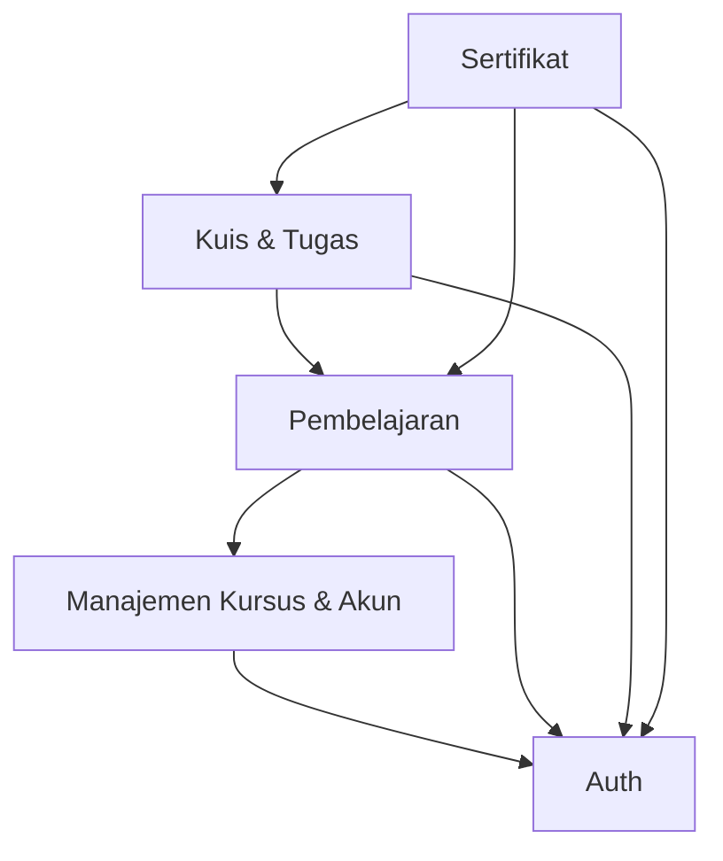

# D2. Module Breakdown

CareerUp dibagi menjadi **5 modul**. Setiap modul punya satu tanggung jawab utama supaya mudah dipahami dan dikerjakan terpisah.

## Daftar Modul

### 1. Auth
**Tanggung jawab:** Mengatur pendaftaran dan login semua pengguna, serta memastikan setiap aktor hanya bisa mengakses fitur sesuai perannya (Peserta, Mentor, Admin).

**Fitur utama:**
- Daftar akun peserta
- Login dan logout
- Pembatasan akses berdasarkan peran

### 2. Manajemen Kursus & Akun
**Tanggung jawab:** Dipakai Admin untuk menyiapkan wadah kursus dan mengatur siapa saja yang bisa memakai sistem. Modul ini juga menyediakan ringkasan angka untuk dipantau Admin.

**Fitur utama:**
- Membuat dan menonaktifkan jalur kursus
- Menambah akun mentor dan memblokir akun bermasalah
- Melihat ringkasan jumlah peserta dan jumlah kelulusan
- Menampilkan daftar jalur kursus yang aktif untuk dipilih peserta

### 3. Pembelajaran
**Tanggung jawab:** Menyajikan materi dalam urutan yang jelas dan mencatat sejauh mana peserta sudah belajar. Mentor menyiapkan materi di modul ini.

**Fitur utama:**
- Peserta memilih jalur belajar
- Peserta membaca materi per bagian secara berurutan
- Menandai materi selesai dan menghitung progres (persentase)
- Mentor menambah dan mengubah materi

### 4. Kuis & Tugas
**Tanggung jawab:** Menguji pemahaman peserta lewat kuis dan tugas, lalu menyimpan nilainya. Kuis dinilai otomatis, tugas dinilai mentor.

**Fitur utama:**
- Peserta mengerjakan kuis dan melihat skor
- Peserta mengulang kuis jika nilai kurang
- Peserta mengumpulkan tugas
- Mentor menilai tugas dan memberi masukan

### 5. Sertifikat
**Tanggung jawab:** Memeriksa apakah peserta memenuhi syarat kelulusan, lalu menerbitkan sertifikat jika memenuhi. Syarat: progres belajar 100% dan nilai rata-rata minimal 70.

**Fitur utama:**
- Mengecek kelayakan sertifikat (progres dan nilai rata-rata)
- Menerbitkan sertifikat dengan nomor unik
- Peserta melihat dan mengunduh sertifikatnya

## Ketergantungan Antar Modul

| Modul | Bergantung pada | Alasan |
|---|---|---|
| Auth | (tidak ada) | Modul dasar yang berdiri sendiri |
| Manajemen Kursus & Akun | Auth | Hanya Admin yang login yang boleh mengelola kursus dan akun |
| Pembelajaran | Auth, Manajemen Kursus & Akun | Peserta harus login, dan materi berada di dalam jalur kursus yang dibuat Admin |
| Kuis & Tugas | Auth, Pembelajaran | Kuis dan tugas melekat pada materi, dan peserta harus login |
| Sertifikat | Auth, Pembelajaran, Kuis & Tugas | Butuh data progres (Pembelajaran) dan nilai (Kuis & Tugas) untuk menentukan kelulusan |

*Panah dibaca "bergantung pada". Contoh: Sertifikat bergantung pada Kuis & Tugas.*

## Catatan
Modul **Sertifikat** adalah tempat fungsi yang diuji di D7 (`is_eligible_for_certificate`), karena fungsi itu menggabungkan data dari Pembelajaran (progres) dan Kuis & Tugas (nilai).
