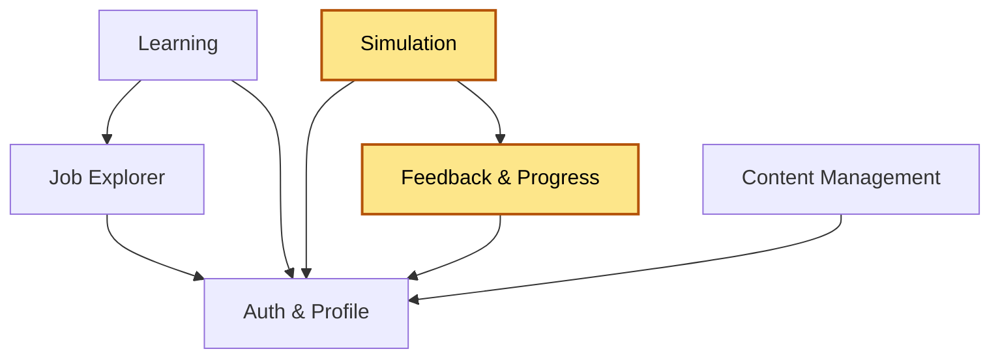

# D2. Module Breakdown

Inti CareerUp adalah **simulasi pekerjaan**: pengguna mencoba mengerjakan tugas yang meniru pekerjaan aslinya, lalu mendapat feedback. Modul lain mendukung alur itu, yaitu membantu pengguna memilih pekerjaan, mempersiapkan skill, dan mencatat hasilnya.

CareerUp dibagi menjadi **6 modul**: dua modul inti (⭐) dan empat modul pendukung.

| Peran | Modul |
|-------|-------|
| ⭐ Inti | Simulation, Feedback & Progress |
| Pintu masuk | Job Explorer |
| Persiapan | Learning |
| Pendukung | Auth & Profile, Content Management |

**Alur pengguna:** Job Explorer (pilih pekerjaan) → Learning (siapkan skill) → ⭐ Simulation (kerjakan tugas) → ⭐ Feedback & Progress (lihat hasil)

---

## Daftar Modul

### 1. Auth & Profile
**Tanggung jawab:** Mengurus akun pengguna, hak akses berdasarkan peran (Job Seeker atau Admin), dan data profil termasuk pekerjaan target.

**Fitur utama:**
- Register akun baru
- Login dan logout
- Membedakan peran Job Seeker dan Admin
- Memeriksa hak akses sebelum fitur dibuka
- Menyimpan pekerjaan target pengguna di profil (Set Target Job)

### 2. Job Explorer
**Tanggung jawab:** Menjadi pintu masuk pengguna: menampilkan pekerjaan beserta skill-nya, lalu menampilkan roadmap sesuai pekerjaan target pengguna.

**Fitur utama:**
- Melihat dan mencari daftar pekerjaan (Browse Jobs)
- Melihat gambaran pekerjaan dan skill yang dibutuhkan (View Required Skills)
- Menampilkan roadmap sesuai pekerjaan target: skill yang perlu disiapkan dan simulasi yang tersedia (View Learning Roadmap)

### 3. Learning
**Tanggung jawab:** Menyiapkan pengguna sebelum simulasi lewat materi singkat yang hanya berisi skill yang akan dipakai di tugas simulasi.

**Fitur utama:**
- Materi singkat per skill, terhubung ke tugas simulasi yang relevan (Learn Skill Material)
- Latihan interaktif sebagai pemanasan (Do Interactive Practice)
- Menandai materi selesai
- Menunjukkan skill mana yang sudah siap dan mana yang belum

> Belajar bersifat **dianjurkan, bukan syarat**. Pengguna tetap boleh langsung membuka simulasi.

### 4. ⭐ Simulation
**Tanggung jawab:** Menjalankan simulasi pekerjaan: menyajikan situasi kerja, tugas bertahap, memeriksa jawaban, dan menghitung skor.

**Fitur utama:**
- Memilih skenario kerja, misalnya "Hari pertama sebagai Admin Data Entry" (Choose Simulation Scenario)
- Menampilkan tugas bertahap seperti yang dikerjakan di tempat kerja nyata
- Tugas yang bisa dinilai otomatis (pilihan ganda dan isian singkat), sehingga skor dihitung dari jumlah jawaban benar
- Validasi jawaban (misalnya tidak boleh ada yang kosong) (Submit Task Answers)
- Menghitung skor dan status kesiapan (`evaluate_simulation`)

### 5. ⭐ Feedback & Progress
**Tanggung jawab:** Memberi feedback atas hasil simulasi dan mencatat perkembangan pengguna.

**Fitur utama:**
- Feedback sesuai status: Siap / Hampir Siap / Perlu Latihan Lagi (Generate Feedback, View Feedback)
- Saran skill atau materi yang perlu diulang saat skor rendah
- Mengulang simulasi saat skor rendah (Retry Simulation)
- Riwayat hasil simulasi
- Progres per pekerjaan (View Progress)

### 6. Content Management
**Tanggung jawab:** Memberi Admin alat untuk mengelola semua konten platform, terutama skenario dan tugas simulasi.

**Fitur utama:**
- CRUD pekerjaan dan skill (Manage Jobs & Skills)
- CRUD materi belajar (Manage Learning Materials)
- CRUD skenario dan task simulasi beserta kunci jawaban (Manage Simulation Tasks)
- Mengelola teks dan aturan feedback (Manage Feedback Rules)

---

## Ketergantungan Antar Modul

> Arti panah: `A --> B` berarti modul A **bergantung pada** modul B. Modul berwarna kuning adalah modul inti.

| Modul | Bergantung ke | Alasan |
|-------|---------------|--------|
| Auth & Profile | (tidak ada) | Modul dasar, tidak memerlukan modul lain. |
| Job Explorer | Auth & Profile | Perlu tahu siapa penggunanya dan membaca pekerjaan target dari profil. |
| Learning | Auth & Profile, Job Explorer | Materi ditampilkan sesuai skill dari pekerjaan target. |
| Simulation | Auth & Profile, Feedback & Progress | Perlu tahu siapa yang mengerjakan, dan hasilnya dikirim ke Feedback & Progress. |
| Feedback & Progress | Auth & Profile | Hasil dan progres disimpan per pengguna. |
| Content Management | Auth & Profile | Hanya Admin yang boleh mengelola konten (cek peran). |

### Catatan Desain
- **Tidak ada ketergantungan melingkar.** Auth & Profile hanya menyimpan `jobId` sebagai referensi pekerjaan target, tanpa memanggil Job Explorer. Pemilihan pekerjaan dikoordinasi oleh UI.
- **Simulation tidak bergantung pada Learning.** Simulasi tidak mewajibkan materi selesai. Hubungan keduanya hanya lewat data (tiap task punya skill terkait), sehingga Feedback & Progress bisa menyarankan materi yang perlu diulang.
- **Content Management berbagi database dengan modul lain**, bukan memanggil modul lain. Karena itu ketergantungannya hanya ke Auth & Profile untuk cek peran Admin.

---

[← Kembali ke README](../README.md)github.com/AZZAMAF/CarerrUp_UAS_SDF/blob/main/README.md)
